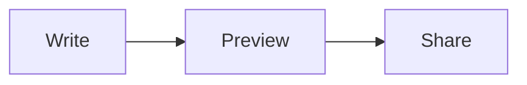

# Markdown Editor

Welcome to the Markdown Editor! This WYSIWYG editor supports the syntax below.

## Headings

# Heading 1
## Heading 2
### Heading 3
#### Heading 4
##### Heading 5
###### Heading 6

## Inline formatting

**Bold**, *italic*, ~~strikethrough~~, ==highlight==, `inline code`, and a [link](https://www.oneboxable.com).

## Lists

- Bullet item one
- Bullet item two
- Bullet item three

1. Numbered item one
2. Numbered item two
3. Numbered item three

- [ ] To-do item
- [x] Completed item
- [ ] Another to-do

## Quotes

> A quote can span multiple lines.
> It can also contain **bold text** and `inline code`.

## Code

Inline code: `val name = "OneBox"`.

```kotlin
fun main() {
    println("Hello, Markdown!")
}
```

## Tables

| Capability | Description | Status |
| :--- | :---: | ---: |
| Live preview | See the result while typing | Supported |
| Tables | GFM table syntax | Supported |
| Task lists | Checkable to-dos | Supported |

## Math

Inline math: $E = mc^2$.

$$
\int_0^1 x^2\,dx = \frac{1}{3}
$$

## Diagrams



## Images and dividers


---

## Footnotes

Here is a footnote reference[^1].

[^1]: This is the footnote text. Tap the marker to jump back.

## How to use

1. Top-right save button: save as a `.md` file
2. Top-right more menu: new, open, save as, export PDF
3. Bottom dock: edit/source, voice, undo/redo, formatting, table, checklist and inserts

Happy writing!
